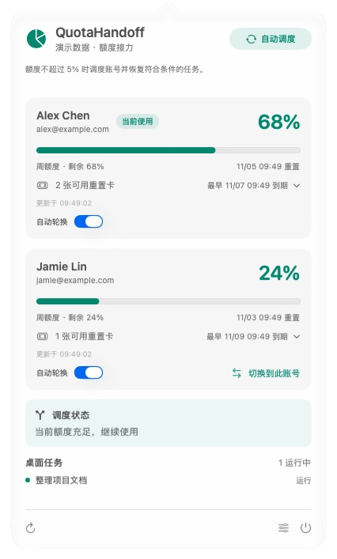
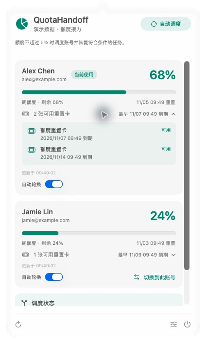
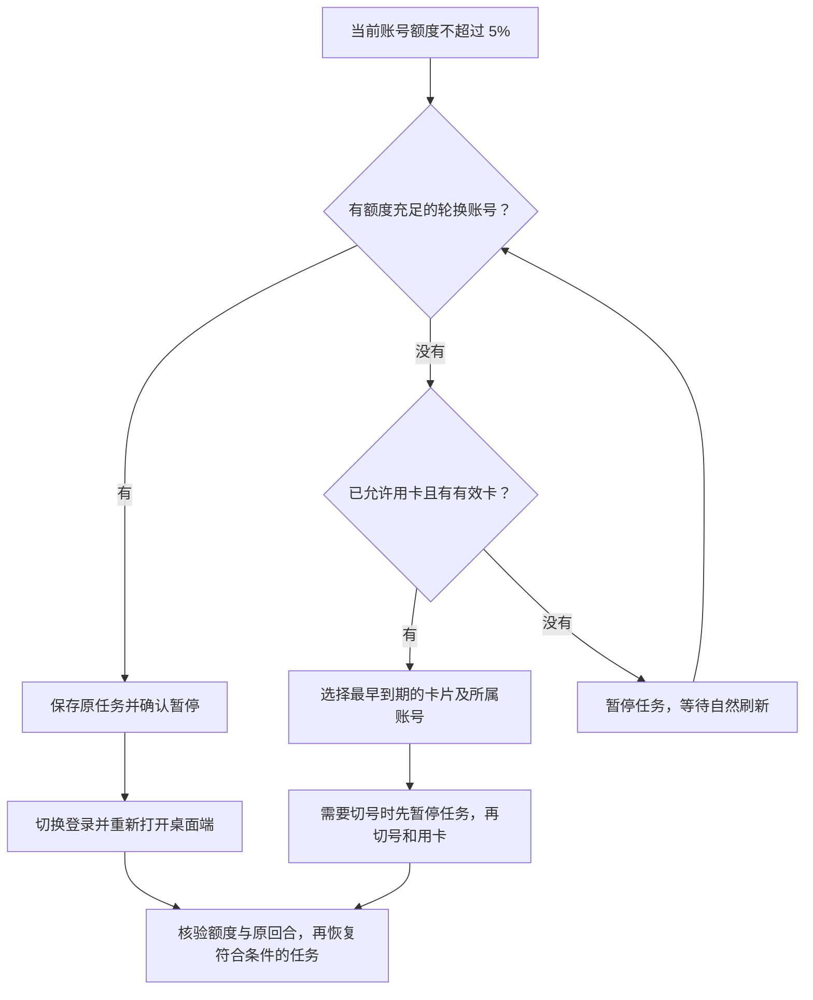
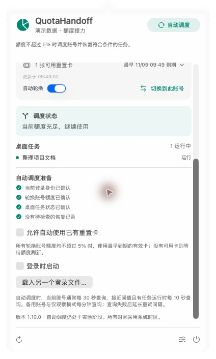

<div align="center">

# QuotaHandoff · 额度接力

**把额度留在菜单栏，把注意力留给工作。**

macOS 上的 ChatGPT / Codex 多账号额度监控与切换工具。

原生 SwiftUI 界面 · 本机钥匙串 · 可选自动调度 · MIT 开源

A native macOS menu-bar companion for ChatGPT / Codex quota monitoring,
account switching, and experimental task handoff.

[快速开始](#快速开始) · [工作方式](#工作方式) · [隐私与凭据](#隐私与凭据) · [开发](#开发)

</div>

## 看一眼，就知道下一步

<p align="center">
  
  
</p>

> 截图来自应用的原生界面，使用内置演示数据。账号、邮箱、额度与任务均为虚构；演示版不访问登录文件、钥匙串或真实聊天。

- **多账号，一处查看**：剩余额度、刷新时间、账号名称、重置卡和到期时间。
- **手动切换**：在面板中选择账号，适用于账号设置等操作，不受目标剩余额度限制。
- **额度接力**：开启自动调度后，当前额度不超过 5% 时寻找可用账号；全部不足时按有效重置卡的到期顺序处理。
- **尊重手动操作**：检测桌面端登录变化；恢复前核对原聊天、原回合及用户操作，避免盲目续跑。
- **本机管理**：凭据存入 macOS 钥匙串；无遥测或自建转发服务。额度查询仍会连接 OpenAI 服务。

这是独立社区项目，与 OpenAI 无隶属或背书关系。自动调度属于实验功能，依赖桌面端的非稳定接口。建议从“仅观察”开始；兼容边界见[已知限制](#已知限制)。

## 快速开始

### 1. 准备环境

- macOS 13 或更新版本；当前已在 Apple Silicon 上构建验证，Intel 未验证。
- Apple Command Line Tools（`xcode-select --install`），提供 Swift 编译器及 `/usr/bin/python3`。
- 安装并登录支持 Work 本地聊天的 ChatGPT / Codex 桌面端。当前桌面控制路径针对 `/Applications/ChatGPT.app`。
- 后端使用 Python 标准库，无需 `pip install`。

### 2. 构建并安装

下载此仓库，进入项目目录，执行：

```sh
bash scripts/build.sh
```

将 `dist/QuotaHandoff.app` 拖到自己的 `~/Applications` 文件夹，然后在 Finder 中打开。首次构建为本地 ad-hoc 签名，不是 Apple 公证发行版。仓库不附带登录文件或预配置账号。

从旧版“Codex 额度”升级时，先退出旧小组件，再安装新版；不要同时运行两份。账号存储标识与数据目录保持兼容，构建脚本会尽可能复用已有的独立凭据助手，减少重复钥匙串授权。

### 3. 加入账号

1. 小组件默认进入 **仅观察**，识别桌面端当前登录。
2. 在桌面端正常登录另一个账号，小组件会跟随识别；也可在设置中选择“载入另一个登录文件…”，导入自己已有的登录备份。
3. 在账号卡片中决定是否开启“自动轮换”。初始两个账号默认参与轮换，之后新增账号默认仅监控。
4. 点击右上角模式按钮开启自动调度。若需要自动用卡，在设置中单独开启“允许自动使用已有重置卡”。

不需要手动改名登录文件。只有主动导入过的备份路径会被跟踪，不会扫描文件夹收集其他登录文件。钥匙串提示由 macOS 管理；凭据助手变化、系统锁定或权限变化仍可能需要再次授权，小组件不保存系统密码。

## 工作方式

### 三种模式，一个入口

点击右上角状态按钮，循环切换 **仅观察 → 自动调度 → 暂停监控 → 仅观察**。

| 模式 | 行为 |
| --- | --- |
| 仅观察 | 定时更新额度，不自动切换账号或启动任务。 |
| 自动调度 | 按额度、可用卡片和任务状态执行接力。 |
| 暂停监控 | 停止定时查询和自动调度，仍检测登录变化，可手动刷新一次。 |

### 自动调度



以服务端返回的所有额度窗口中的最低剩余值为准。当前账号大于 5% 时保持使用；全部不足时不会在低额度账号间反复切换。卡片属于当前账号时可原地重置；相同到期时间优先当前账号。兑换结果不明确时保留原请求并等待核验，避免重复用卡；不会自动购买额度。

### 手动切换

点击“切换到此账号”并确认后，停止当前运行的聊天，正常退出桌面端，替换登录并重新打开。**不检查目标额度、不使用重置卡、不自动恢复任务**，完成后进入仅观察。适合切到另一个账号修改设置或处理非任务操作。

### 查询间隔

| 情况 | 常规间隔 |
| --- | --- |
| 自动调度下的当前账号 | 30 秒 |
| 当前剩余不超过 15%，且有聊天运行 | 10 秒 |
| 备用账号或仅观察模式 | 60 秒 |
| 已暂停任务、等待额度刷新 | 60 秒，并在预计刷新时间附近复查 |
| 暂停监控 | 不定时查询，允许手动刷新 |

各账号独立排期。连续手动刷新会合并，失败后从约 2 分钟逐步退避至最多 30 分钟，并跨重启保留等待时间。缓存超过 2 分钟不用于决定切号或用卡。5% 是查询确认后的触发阈值，不是瞬时硬上限；这些间隔不保证服务端不会限流。本地界面刷新及任务检查不等同于额度网络请求。

<details>
<summary>展开查看设置界面</summary>

<p align="center"></p>

</details>

## 隐私与凭据

| 数据 | 保存位置 |
| --- | --- |
| 登录凭据 | macOS 钥匙串，服务标识 `local.CodexQuota.accounts.v2` |
| 当前桌面端登录 | 桌面端使用的 `~/.codex/auth.json`；切换时原子替换 |
| 账号显示信息、任务恢复标记、事件、查询等待时间 | `~/Library/Application Support/CodexQuota`，目录权限 `0700`，状态库 `0600` |
| 查询过程临时文件 | 隔离的临时目录，退出后清理，清理失败会重试 |

状态库不保存登录令牌，但账号邮箱、聊天标题、导入路径和运行记录仍属于个人数据，**不要把整个状态目录或日志上传到 Issue**。本仓库只包含源码、合成测试数据和演示截图，忽略登录文件、密钥、状态库及构建产物。

分享截图请使用 `bash scripts/build-demo.sh` 生成的 `dist/QuotaHandoff Demo.app`。它使用独立应用标识，不附带后端或凭据助手，可以与真实版并行打开；截图不需要遮挡真实信息。

卸载前关闭“登录时启动”并退出小组件。移除 `.app` 不会删除原登录文件、钥匙串账号或状态目录。更多细节见 [SECURITY.md](SECURITY.md)。

## 已知限制

- 桌面 IPC 与重置卡接口可能随客户端升级变化；无法确认任务状态时会暂停自动操作。
- 持续运行目标目前会阻止自动切换。手动切换可停止目标，但不会自动恢复。
- 恢复任务通过发送继续指令完成，不是进程快照。已经执行的命令不会回滚；用户手动停止、有新回合或等待输入的任务会跳过。
- 正常退出可能遇到桌面端确认提示；工具不强制杀进程绕过提示。
- 跨账号的云端聊天、插件和组织资源可能无法访问。
- 后台自动登录续期尚未实现；登录过期需重新登录，不会被当作零额度。
- 自动用卡的完整真实兑换流程仍待验证，模拟测试不能替代端到端验证。
- 这不是通用 API Key 负载均衡器，也不处理共享账号的远程任务。

## 开发

```sh
# 不访问真实账号的后端测试
PYTHONDONTWRITEBYTECODE=1 /usr/bin/python3 -m unittest discover -s tests -q

# 构建真实版或独立演示版
bash scripts/build.sh
bash scripts/build-demo.sh

# 提交前检查受跟踪文件及历史中的常见泄露模式
python3 scripts/privacy_check.py --history
```

```text
native/            SwiftUI 面板、AppKit 菜单栏、独立钥匙串助手
backend/           额度归一化、查询排期、调度、桌面 IPC 与凭据适配
scripts/           构建、隐私检查、离线配置工具
tests/            合成数据测试（不连接真实账号）
docs/images/       来自独立演示版的真实截图
```

贡献、兼容性及截图流程见 [CONTRIBUTING.md](CONTRIBUTING.md)；架构见 [docs/ARCHITECTURE.md](docs/ARCHITECTURE.md)。凭据助手的二进制身份应尽量保持稳定，不要在每次界面更新时重建或重新签名它。内部 `CodexQuota` 标识保留用于存储和升级兼容。

## 参考与致谢

- [OpenAI App Server 文档](https://learn.chatgpt.com/docs/app-server)：账号、额度和重置卡接口参考。
- [Gaebabi/codex-switch](https://github.com/Gaebabi/codex-switch)：桌面 IPC 的发现、订阅和续跑协议参考。
- [Apple AppKit](https://developer.apple.com/documentation/appkit) 与 [Security](https://developer.apple.com/documentation/security)：原生界面、正常退出和钥匙串。

## 许可证

[MIT License](LICENSE) · Copyright © 2026 QuotaHandoff contributors.
